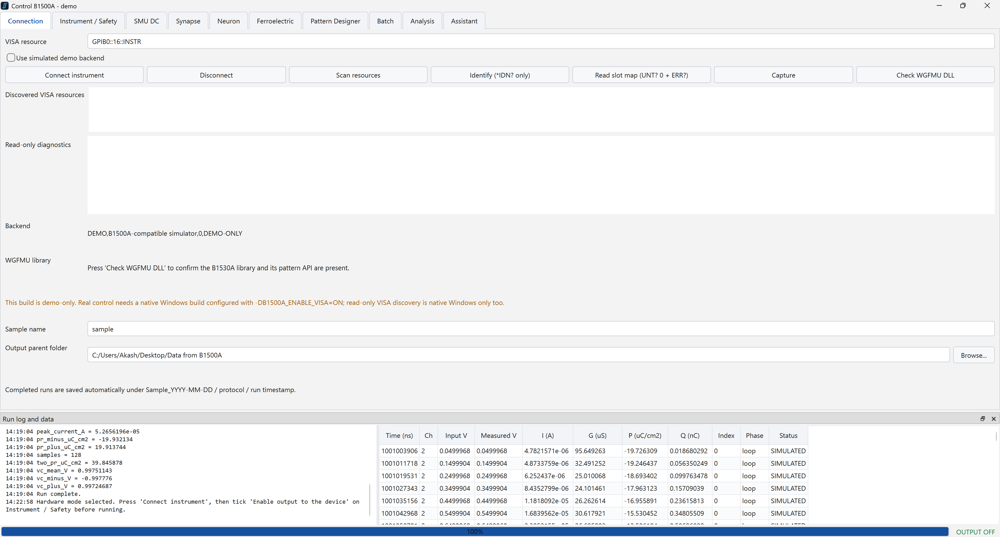
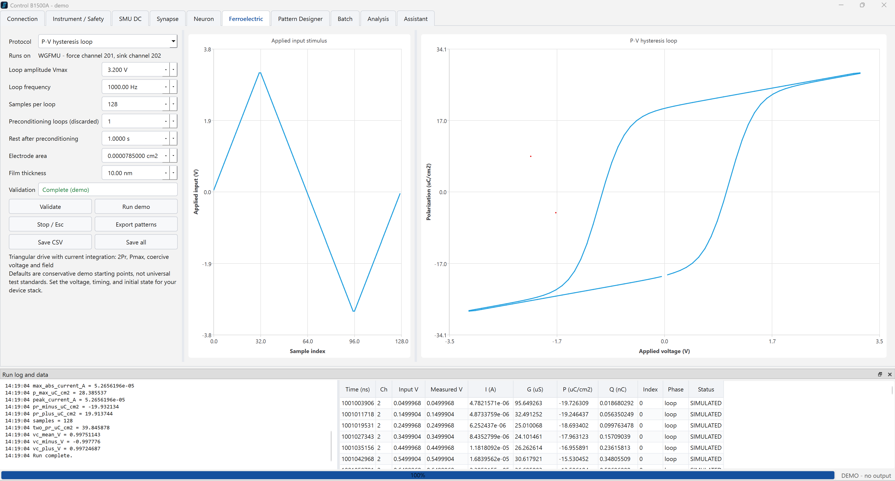

# b1500-gui-cpp

C++/Qt GUI for the **Keysight B1500A Semiconductor Device Analyzer** over **GPIB**, covering the DC, capacitance and fast-pulse measurements used to characterize memristive, ferroelectric and other neuromorphic devices (synaptic plasticity, neuron-like spiking, forming, retention, polarization switching).

     


<p align="center"><em>Connection tab - VISA discovery, backend identity, and where completed runs are written.</em></p>

> A Python port of this application lives at
> [b1500-gui-python](https://github.com/akashnith/b1500-gui-python) -same 42
> protocols, importable as a library. Cross-checking the two found real bugs
> in both.

---

## Instrument

| | |
|---|---|
| **Model** | Keysight (formerly Agilent) B1500A Semiconductor Device Analyzer |
| **Type** | Modular, all-in-one parameter analyzer: IV, CV, pulse / dynamic IV |
| **Architecture** | Mainframe with up to 10 plug-in module slots; installed modules set the limits |
| **Current / voltage range** | 0.1 fA to 1 A, 0.5 µV to 200 V |
| **Capacitance** | Multi-frequency AC capacitance, 1 kHz to 5 MHz; quasi-static CV |
| **Measurement modes** | Spot, sweep, sampling, pulsed, transient, arbitrary waveform |
| **Modules driven here** | **SMU** (DC and staircase), **MFCMU** B1520A (capacitance), **WGFMU** B1530A (waveform generator / fast measurement unit) |
| **Software** | Embedded EasyEXPERT group+ (15-inch touchscreen, Windows) |
| **Remote control** | GPIB / VISA, FLEX command set (this project); WGFMU via the Keysight B1530A instrument library (`wgfmu.h` / `wgfmu.dll`) |

**Links**
- Product page: <https://www.keysight.com/us/en/product/B1500A/semiconductor-device-analyzer.html>
- User's Guide, Programming Guide, B1530A WGFMU documentation, drivers and EasyEXPERT downloads: from the product page above, under *Resources / Software*.

---

## Features

- GPIB connection through VISA (NI-VISA or Keysight IO Libraries Suite); `*IDN?`, `UNT?` module detection and slot-to-channel mapping
- WGFMU pattern generation and execution through the B1530A library, on the 10 ns ALWG grid
- **42 measurement protocols**, grouped by the device they measure:

| family | count | measurements |
|---|---|---|
| **SMU** (DC) | 8 | staircase I-V with independent bipolar limbs, forming / stress, read–retention–disturb, NDR and peak-to-valley, threshold statistics, slow-pulse LTP/LTD, DC endurance, 2-/4-probe resistance |
| **Synapse** | 15 | LTP/LTD trains, write-read, PPF/PPD, STDP, width and amplitude sweeps, repeatability, switching kinetics, SRDP, STP, multilevel write-verify, retention, endurance |
| **Neuron** | 8 | threshold switching, leaky integrate-and-fire, f–I curves, relaxation and recovery, leaky integration, pulsed threshold statistics, pulsed I-V, relaxation oscillator |
| **Ferroelectric** | 11 | PUND, P-V hysteresis, two-frequency leakage separation, antiferroelectric double loops, AFE-PUND, FTJ electroresistance, switching speed, wake-up and fatigue, accumulative switching, plus C-V and Rayleigh sweeps on the MFCMU |


<p align="center"><em>Ferroelectric tab - a P-V hysteresis loop in demo
mode. Left: the triangular drive as it will be applied. Right: polarization
against applied voltage, integrated from the measured current. The run log
reports 2Pr, Pmax and the coercive voltages; every sample is in the table
below it. This is in demo mode but verified the working in hardware mode</em></p>

- **Asymmetric sweeps.** The two limbs of a bipolar I-V are independent magnitudes - a device can SET at +2 V and RESET at −4 V - and each limb is sized from the **step**, not from a point count, so both keep the same resolution
- **Limits are checked before anything is sent.** A waveform that would exceed the ceiling is refused, not clipped: a clipped waveform is a different measurement that looks like the one you asked for
- **Compliance hits are counted, not hidden** -a clipped point is not a measurement, and anything averaged across one is wrong
- SI-aware parameter entry: type `100u`, `1m`, `2.5n` into any compliance, width or timing field
- Live plotting and per-read-point analysis (conductance versus pulse number, polarization versus field, ON/OFF ratio read off the finished loop)
- Pattern preview before execution, and CSV export of every measured point
- **Demo mode** exercises every protocol with no instrument attached - the simulator is a device model, not a stub
- Optional terminal bridge (`tools/b1500ctl.py`) and an in-application assistant pane; both are off by default, the bridge binds to `127.0.0.1` only, and no API key is ever written to disk
- Safe-state handling: outputs driven to zero and released on error, stop, or exit

---

## Requirements

**To build and run against the simulator - any platform**

- C++17 compiler (MinGW 13+, MSVC 2022, GCC, or Clang)
- CMake 3.21+ and Ninja
- Qt 6.2+ with **Widgets, Charts, Test and Network**

Nothing vendor-specific. This is the configuration the CI builds on Linux, Windows and macOS.

**To drive real hardware - additionally, Windows x64**

- **NI-VISA** or **Keysight IO Libraries Suite** (x64)
- **GPIB interface** (NI GPIB-USB-HS or equivalent) and a cable to the B1500A
- Keysight **B1530A WGFMU instrument library**, installed by default under `C:\Program Files\Agilent\B1530A`, for the pulse protocols

CMake refuses a 32-bit hardware build rather than producing one that cannot load the DLL.

---

## Build

```bash
git clone https://github.com/akashnith/b1500-gui-cpp.git
cd b1500-gui-cpp

cmake --preset default            # add - DCMAKE_PREFIX_PATH=<path-to-Qt> if needed
cmake --build --preset default
ctest --preset default
```

Run `build/default/b1500a_neuro_gui` (`.exe` on Windows).

| preset | what it is for |
|---|---|
| `default` | any platform, simulator only - Release |
| `debug` | the same, with symbols |
| `msvc` | Visual Studio 2022, x64 |
| `hardware` | Windows x64, adds the VISA backend and links `wgfmu.lib` |

```bash
# Windows, with the instrument
cmake --preset hardware - DCMAKE_PREFIX_PATH="C:/Qt/6.9.3/mingw_64"
cmake --build --preset hardware
```

`cmake --list-presets` names them all. Set `B1500A_WGFMU_LIBRARY` if the Keysight library is not in the default location.

On Windows, `windeployqt build/default/b1500a_neuro_gui.exe` copies the Qt runtime beside the executable so it runs without Qt on `PATH`.

---

## Quick start

1. Connect GPIB and power on the B1500A. Confirm the instrument is visible in NI-MAX / Keysight Connection Expert (e.g. `GPIB0::16::INSTR`).
2. Launch the app. It opens on the **Connection** tab in demo mode, so steps 3–5 work immediately with nothing connected.
3. Open a family tab - **SMU DC**, **Synapse**, **Neuron** or **Ferroelectric** - pick a protocol from the drop-down, and set amplitudes, pulse widths, compliance and read points. Fields accept SI suffixes: type `100u`, `1m`, `2.5n`.
4. **Validate** checks the waveform against the limits without touching the instrument. **Preview selected protocol** draws the pulse train that would be applied.
5. **Run demo** executes it. The stimulus and the result plot side by side, every sample lands in the table under them, and **Save CSV** / **Save all** export it. Completed runs are also written automatically under the output folder named on the Connection tab, as `Sample_YYYY-MM-DD / protocol / run timestamp`.
6. For real hardware: untick **Use simulated demo backend**, enter the GPIB address, press **Connect instrument** - `*IDN?` and the installed modules are listed - then tick **Enable output to the device** on *Instrument / Safety* before running.

### Headless

```bash
b1500a_neuro_gui --smoke-demo                     # run every protocol, print PASS/FAIL, exit
b1500a_neuro_gui --probe-hardware=GPIB0::16::INSTR # identify the mainframe and its modules
b1500a_neuro_gui --hardware-run --protocol=fe.pv --set=cycles=3 --csv=out.csv
```

---

## Project layout

```
b1500-gui-cpp/
├── CMakeLists.txt
├── CMakePresets.json           # default · debug · msvc · hardware
├── src/
│   ├── app/                    # main window, run worker, SI-aware spin box, bridge
│   ├── core/                   # protocol catalogue, pattern builder, analysis, CSV
│   ├── instruments/            # VISA/FLEX backend, WGFMU wrapper, simulator
│   └── ai/                     # optional assistant client
├── tests/                      # core tests + a mock WGFMU library
├── resources/                  # application icon and Qt resources
├── presets/                    # example device presets
├── tools/                      # terminal bridge
├── docs/                       # architecture, bring-up, measurements, status
│   └── images/                  # the screenshots above
└── .github/workflows/ci.yml    # builds and tests on Linux, Windows, macOS
```

---

## Documentation

| | |
|---|---|
| [docs/architecture.md](docs/architecture.md) | how the layers fit together, and why the split is where it is |
| [docs/bringup.md](docs/bringup.md) | getting this talking to your own instrument for the first time |
| [docs/measurements.md](docs/measurements.md) | the full protocol catalogue, with what each one reports |
| [docs/instrument-notes.md](docs/instrument-notes.md) | what the B1500A actually does, as opposed to what the manual says |
| [docs/terminal-bridge.md](docs/terminal-bridge.md) | driving the running GUI from a terminal |
| [docs/status.md](docs/status.md) | which protocols have been verified against hardware |

---

## Safety

Verify sample voltage limits and compliance before running. The limits in this software are **a check on what the program is asked to send** -they are not a safety interlock, and they cannot protect a device, an instrument or a person from a wiring mistake.

A return path that is not actually connected reads as a very good insulator rather than as an error. Set the compliance for the device, not for the measurement you hope to get, confirm pattern amplitudes in the preview, and use the stop control if the response looks wrong.

---

## Roadmap

- [ ] SPGU protocol coverage (pulse widths between the SMU and WGFMU ranges)
- [ ] Batch protocol sequencing across devices
- [ ] Export of WGFMU patterns to EasyEXPERT format
- [ ] Reset-before-read in accumulative polarization switching - a PUND read is destructive, so the present implementation measures the first point and then a flat line

---

## License

MIT. See `LICENSE`.

No Keysight source code, header, library or manual content is redistributed here; driving a B1530A requires Keysight's own `wgfmu.dll`, installed with their software.

*Keysight, Agilent, B1500A, EasyEXPERT, B1520A and B1530A are trademarks of Keysight Technologies. This project is independent and not affiliated with or endorsed by Keysight.*
